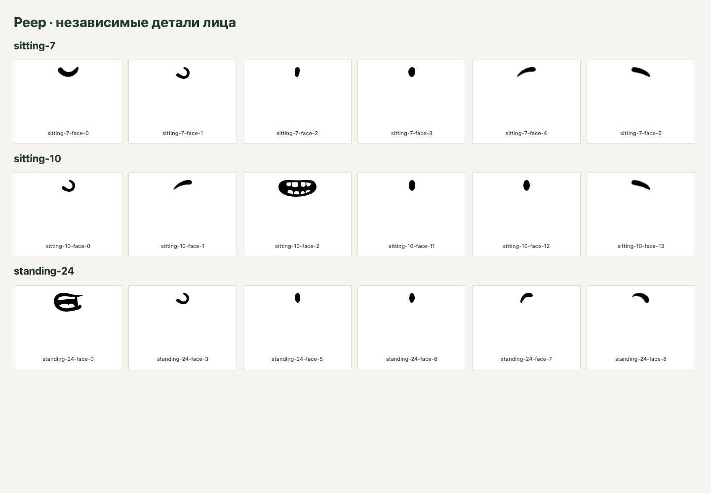

# Повтор этапа 3: извлечение деталей SVG на основе этапа 7

> Обновление после аудита: отдельные экспериментальные страницы удалены; SVG-проверки сохранены в тестовых фикстурах. Старые URL в этом отчёте относятся к состоянию на момент этапа. [Актуальный аудит](audit-stages-1-9.md).

> Исторический отчёт предварительной проверки. После него пользователь поручил интеграцию: она выполнена и описана в [отчёте этапа 7](stage-7.md). Общая реализация перенесена в `src/svg`, стенды продолжают использовать её через совместимые экспорты.

Дата: 18 октября 2026 года. Статус: изолированный эксперимент выполнен и проверен. Интеграция в основной редактор и БЭ в это поручение не входит; этап 7 целиком не объявляется завершённым.

## Результат

В каждом из трёх предоставленных Peep теперь извлекаются **рот, нос, два глаза и две брови**. Другие исходники для этого не понадобились. Результат — самостоятельный SVG с прозрачным фоном, собственным viewBox и сохранённым контекстом оформления. Голова, поза и несколько объектов тоже извлекаются.

Новый алгоритм проверен на **52 независимых визуальных случаях**: максимальная разница пиксельных каналов во всех случаях равна **0**. Исходный SVG DOM не изменяется. Каждый результат дополнительно отрисован на новой пустой странице после удаления страницы с исходником; изображение совпадает с сохранённым PNG результата с допустимым отклонением не более одного уровня канала. PNG используются только для проверки, экспорт остаётся векторным.

Общий прогон: **64 Vitest-проверки и 95 Playwright-проверок**. Из них новый эксперимент — 19 Vitest и 66 Playwright; прежние 45 и 29 проходят. TypeScript и production-сборка проходят.



## Что изменено относительно предложения этапа 7

| Предложение | Принятое решение | Причина |
| --- | --- | --- |
| Разделять каждый `M…Z` на самостоятельный path при загрузке | Виртуальные детали поверх неизменного SVG; материализация только в удаляемой копии при извлечении | Разделение при отображении может уничтожить отверстия и изменить заливку/композицию |
| Атомарный подконтур равен самостоятельной детали | Анализ вложенности, `evenodd`/`nonzero`, пересечений и отверстий | Рот с зубами должен извлекаться вместе с внутренними контурами |
| Пространственная группировка по пересечению bbox | Группы из структуры SVG; bbox только для отсечения геометрических проверок и консервативного объединения неоднозначных контуров | Пересечение прямоугольников не доказывает принадлежность частей одному смысловому объекту |
| Клик / глубокий клик | Клик — ближайшая группа; двойной клик — самая мелкая доступная деталь; Shift + клик — добавить/исключить самую мелкую деталь; Esc — снять выделение | После обратной связи пользователя убраны Alt и скрытый контекст входа в группу |
| Перенести связанные defs | Сначала зафиксировать исходные bbox-зависимые координаты, затем перенести зависимости | Уменьшение `d` иначе изменяет градиент и маску даже при сохранении самих defs |
| Суффикс к ID | Уникальный ID каждому перенесённому узлу и переписывание ссылок | В реальных Peep уже повторяются исходные ID |
| Абсолютно любые SVG | Явное статическое подмножество и понятные отказы | Универсальная совместимость предложенным алгоритмом не обеспечивается |

Сохранение в БЭ, модальное имя и встраивание в ХИ намеренно остаются следующей интеграционной работой, как и было оговорено перед повтором этапа 3.

## Алгоритм и устройство

1. Исходник проверяется существующим `parseSvg` и монтируется в отдельный Shadow DOM. Оригинальные файлы и `public/demo` не переписываются. Новому эксперименту не нужны подготовленные `data-component`-копии Peep.
2. `svg-pathdata` разбирает реальные команды SVG, переводит относительные координаты в абсолютные и раскрывает `S/T`. Разделение регулярным выражением в рабочем алгоритме не используется. Дуги остаются командами `A` в экспортируемой геометрии.
3. Paper.js применяется только для анализа геометрии: пересечений, вложенности, направления обхода. Он не перерисовывает исходник и не пересобирает его кривые для экспорта. Операции булевой перерисовки не применяются.
4. Контуры отверстий привязываются к заполненной области. Пересекающиеся/касающиеся контуры сохраняются в одном кластере. Самопересекающийся контур сохраняется без изменения; соседние контуры с пересекающимися bbox консервативно привязываются к нему. Независимые детали в том же path остаются доступными.
5. Для открытых/вырожденных подконтуров и при превышении 128 подконтуров либо 5000 сегментов анализ оставляет объект целиком с объяснением. Эти ограничения относятся к одному path, а не гарантируют предельное время для любого документа.
6. Кандидаты адресуются порядковым номером исходного узла и индексами подконтуров. Повторяющиеся исходные ID не мешают выбору. Геометрические пробы хранятся в отдельном скрытом SVG. Попадание проверяется нативными `isPointInFill`/`isPointInStroke` после пересчёта экранной точки через CTM. Индексы кандидатов и деталей каждого узла кэшируются; при клике не повторяется топологический разбор и не сканируются детали всех остальных путей.
7. Перед экспортом удаляются дубли выбора и потомки выбранных групп. Несколько деталей одного path материализуются обратно в **один** path в исходном порядке, чтобы не дублировать полупрозрачные слои.
8. В рабочей копии до изменения `d` и удаления соседних ветвей фиксируются рамки выбранных фигур и их предков. Bbox-градиенты переводятся в числовой `userSpaceOnUse` с исходной матрицей; bbox-маски и clipPath также сохраняют исходную систему координат. Наследование градиентов через href учитывается.
9. Неизменённый экспортёр первого этапа 3 переносит родительские transform, вычисленные стили, замыкание локальных зависимостей, назначает уникальные ID, рассчитывает рамку и нормализует viewBox к `0 0 width height`. Рабочая копия удаляется в `finally`.

Основные файлы: [topology.ts](../experiments/svg-v2/topology.ts), [model.ts](../experiments/svg-v2/model.ts), [resources.ts](../experiments/svg-v2/resources.ts), [extract.ts](../experiments/svg-v2/extract.ts), [harness.ts](../experiments/svg-v2/harness.ts).

Новые зависимости: `svg-pathdata` 9.0.0 и `paper` 0.12.20, версии закреплены lock-файлом. Используется `paper-core`; геометрическая библиотека включена в отдельную страницу эксперимента, основной редактор её не импортирует. Production JS новой страницы — около 246 КБ без сжатия / 85 КБ gzip, плюс общий SVG-модуль около 12,5 / 5,1 КБ. Это стоимость проверенного геометрического анализа; библиотека не добавлена в поток открытия основного редактора.

Справочные источники: [Paper Path](https://paperjs.org/reference/path/), [Paper PathItem](https://paperjs.org/reference/pathitem/), [SVGPathData](https://github.com/nfroidure/svg-pathdata).

## Фактические детали Peep

Индексы ниже отсчитываются от нуля в исходном составном пути лица. Эти соответствия визуально проверены; алгоритм не присваивает автоматически смысловые названия «рот»/«глаз».

| Исходник | Рот | Нос | Глаза | Брови | Деталей лица |
| --- | --- | --- | --- | --- | --- |
| sitting-7 / Smile | 0 | 1 | 2, 3 | 4, 5 | 6 |
| sitting-10 / Smile-Teeth-Gap | 2–10 вместе, восемь отверстий | 0 | 11, 12 | 1, 13 | 6 |
| standing-24 / Explaining | 0–2 вместе, два отверстия | 3–4 вместе | 5, 6 | 7, 8 | 6 |

На всём рисунке sitting-7 доступно 9 виртуальных деталей, на двух остальных — по 6. Это дополнение к выбору целых фигур и групп, а не число всех выбираемых объектов.

**Волосы:** отдельный узел/группу головы можно выбрать глубже. Но волосы, лицо и линия головы местами слиты в один непрерывный контур. Алгоритм не восстанавливает смысловую границу внутри него. Для отдельной полной причёски в таких случаях нужны подготовленные отдельные контуры или ручное редактирование геометрии. Наличие `open-peeps-mono.fig` само по себе не считается доказательством подходящих слоёв: импорт и проверка его внутренней структуры в этой работе не выполнялись.

## Доказательства и независимость проверки

Набор [svg-v2.spec.ts](../src/tests/svg-v2.spec.ts) содержит:

| Случаи | Количество |
| --- | ---: |
| Отдельные детали лица трёх Peep | 18 |
| Головы и позы | 6 |
| Обратная сборка всех деталей каждого лица | 3 |
| Левая/правая части под linearGradient, radialGradient, bbox clipPath, bbox mask предка | 8 |
| Отверстия evenodd и относительные дуги | 4 |
| Прежние CSS, href-зависимости, маска/clipPath, поворот и толстая обводка через новый экспорт | 4 |
| Nonzero, пересечение, самопересечение, обводка части, относительные S/T | 9 |
| **Всего визуальных случаев** | **52** |

Эталоны Peep собираются из исходных абсолютных `M`-контуров по явно заданным индексам. Здесь регулярное выражение используется только как независимый разбор известного формата тестовых оригиналов; наличие относительного `m` в них запрещено проверкой. Эталоны технических фигур и исходные матрицы градиентов/масок заданы вручную, отдельно от анализатора. Новый анализатор не используется для получения ожидаемого `d`. Это защищает от теста, в котором одна и та же ошибка повторилась бы в результате и эталоне.

Рендер сравнивается в Chrome в RGBA с учётом прозрачности. Во всех 52 случаях `maxDelta = 0`, отличающихся пикселей нет. Для маски и градиента проверены обе удалённые друг от друга части: неверное перерастягивание ресурса на новую рамку было бы заметно.

Четырнадцать дополнительных Playwright-сценариев проверяют настоящие одиночный/двойной/Shift-клики, масштаб, Esc, скачивание; десять одновременно вставленных SVG с изолированными ID и локальными ссылками; измерения скорости; формирование наглядного листа деталей. Выделение, масштабирование и экспорт не меняют исходный DOM. Все 52 результата также проверяются после уничтожения исходной страницы.

Дополнительно проверены реальное ближайшее вложенное имя-независимое `g`, пересчёт точки при transform, сужение выбранного родителя через Shift без потери других объектов и поведение кликов по фону.

Новые Vitest-проверки выполняются в настоящем Chrome, без подмены `getBBox`: команды и дуги, отверстия и острова evenodd/nonzero, пересечения, самопересечение, открытый контур, лимит сложности, три лица, нормализация выбора, один слой для нескольких деталей, замораживание градиента, отказ при неоднозначном ID и viewport-зависимых процентах.

Артефакты: [сводка](stage-3-v2-artifacts/summary.json), [каталог SVG, эталонов, PNG и метрик](stage-3-v2-artifacts), [лист деталей](stage-3-v2-artifacts/face-details.png), [лаборатория](stage-3-v2-artifacts/laboratory.png), [проверка неизменности](stage-3-v2-artifacts/unchanged.json). SHA-256 старого экспортёра, `App.tsx` и сервиса хранилища совпадает со значениями перед работой. Все три `public/demo` побайтово совпадают с исходными материалами.

## Скорость

Измерения одного локального прогона Chrome 155.0.8059.80 приведены в [performance.json](stage-3-v2-artifacts/performance.json). Замеряется подготовка модели, 200 глубоких выборов с кешем и одно извлечение. На синтетике выбирается деталь последнего path, а не только первого.

Подготовка трёх реальных Peep занимает порядка 7–10 мс, извлечение — порядка 1–3 мс; p95 глубокого выбора — около 0,1 мс. На синтетическом файле из 500 path / 1000 деталей подготовка — порядка 18 мс, извлечение — около 4 мс. Нулевые отдельные замеры означают предел точности браузерного таймера. Сетевое чтение, монтаж и наполнение списка отдельно входят в `loadMs`.

Это ориентир данного компьютера и простых синтетических фигур. Сравнение ускорения с прежним алгоритмом не заявляется: он решал другую задачу. Worker, пространственный индекс всего документа и проверка многомегабайтных сложных иллюстраций не выполнялись. Перед расширением библиотеки нужны реальные новые SVG и замеры на них.

## Контракт и ограничения

Сохраняется подмножество статического SVG из [первого отчёта](stage-3.md). Расширение — выбор независимых частей составного path и фиксация bbox-ресурсов перед частичным извлечением. Открытый/вырожденный либо слишком сложный составной путь остаётся доступен целиком. Неоднозначно связанные контуры группируются консервативно: мелкость выбора может уменьшиться ради сохранения изображения.

- `use/symbol`, pattern, фильтры, текст/шрифты, растр, внешние ресурсы, анимации, произвольный CSS и вложенные SVG не поддерживаются. Неподдерживаемый файл отклоняется явно.
- Процентные координаты `userSpaceOnUse`-градиентов, включая неуказанные процентные значения по умолчанию, и процентная область `userSpaceOnUse`-маски отклоняются при извлечении с кодом `VIEWPORT_RESOURCE_UNITS`. После смены viewport они могли бы изменить изображение. Числовые координаты и проверенные bbox-варианты допустимы; автоматическое исправление всех viewport-процентов не заявляется.
- Рамка рассчитывается по геометрии с консервативным запасом для обводки/поворота. Маски и клиппинг не сжимают её по оставшимся видимым пикселям. Прозрачные поля возможны; это не обещание минимальной видимой рамки.
- Если требуется сохранить исходное обрезание корневым viewport, действует прежний понятный отказ `ROOT_CLIPPING`.
- Paper.js анализирует кривые численно; это не формальное доказательство корректности любой патологической геометрии. Проверенный набор и консервативные отказы не заменяют проверку новых файлов.
- Автоматического распознавания анатомии нет. Новые отдельные названия в демонстрационном отчёте получены визуальной проверкой.
- Проверен Chrome на macOS, не Safari/Firefox и не импорт во все внешние редакторы.
- Библиотека по-прежнему содержит три предоставленных Peep. Тестовые фигуры не засчитываются в требуемые 20 иллюстраций.

## Запуск и граница следующей работы

```sh
npm ci
npm run build
npm test
npm run dev
```

Открыть `/experiments/svg-v2/index.html` на адресе Vite. Один клик выбирает ближайшую группу; двойной клик по видимому глазу/рту выбирает самую мелкую доступную деталь. Shift + клик добавляет или исключает такую деталь, Esc снимает выделение. Alt не используется. Её также можно выбрать из списка «Объект или деталь». Нажать «Извлечь выделение» и «Скачать SVG». Превью увеличивает мелкие детали только визуально, размеры экспортируемого SVG сохраняются. Старый контрольный стенд остаётся на `/experiments/svg/index.html`.

Отдельный запуск: `npm run test:unit`, затем `npm run test:svg:v2`; проверки доступа мышью к лицам — `npx playwright test svg-selection.spec.ts`. Несколько Playwright-команд одновременно в этом checkout не запускать. Нужен установленный Google Chrome; используется `channel: chrome`.

Следующая работа этапа 7 — подключить этот модуль к ХИ, реальным элементам управления и уже существующему сервису сохранения БЭ, согласовав состояние выделения и ошибки. После интеграции потребуется отдельная проверка всей цепочки: исходник из БИ → деталь → имя → IndexedDB → миниатюра → экземпляр композиции. Текущий успешный эксперимент не подменяет эту приёмку.


## Исправление управления после обратной связи пользователя

Первоначальная визуальная приёмка подтверждала правильность выделенных через API контуров. Проверка мыши использовала технические фигуры и Alt и не доказывала доступ к реальным лицам двойным кликом. Пользователь обнаружил этот пробел. Причины воспроизведены отдельным падающим тестом: на sitting-7 двойной клик по рту давал пустой выбор.

В старом обработчике двойной клик только менял скрытый контекст группы и очищал выделение. Глубокое попадание в подконтур запускалось через Alt; Shift использовал обычный выбор группы. При совместном выборе родителя и детали нормализация оставляла родителя, поэтому добавление детали не имело видимого эффекта.

Теперь двойной клик сразу выбирает мельчайшую доступную деталь под указателем с сохранением её отверстий. Shift использует тот же глубокий поиск и переключает деталь в наборе. Если выбран её родитель, он заменяется этой деталью, а независимые выбранные объекты сохраняются. Обычный клик каждый раз выбирает ближайший реальный `g`, в том числе без специального имени и с единственным дочерним узлом; скрытого режима больше нет. В последовательности браузерных событий `click(1) → click(2) → dblclick` второй обычный клик не выполняет повторный сброс, а Shift-dblclick не запускает дополнительное одиночное глубокое выделение после двух переключений.

Новый [svg-selection.spec.ts](../src/tests/svg-selection.spec.ts) проверяет **все 18 деталей** настоящими движениями мыши и двойными кликами при **50%, 100% и 200%**. Координата берётся из заполненной области, округляется до CSS-пикселя и проверяется нативным `elementFromPoint` по исходному рисунку. Выбор не устанавливается программным `select()` и события не подделываются через `dispatchEvent`. Для каждой из девяти комбинаций «исходник × масштаб» проверены два глаза через Shift, повторное исключение, экспорт выбранной пары одним path, сужение группы, Esc и неизменность DOM. Отдельно проверены прозрачное отверстие, Shift по фону и Shift-dblclick.

Доказательства: [два глаза, выбранные мышью](stage-3-v2-artifacts/mouse-two-eyes.png) и девять файлов `mouse-*.json` в каталоге артефактов. Прежние 52 сравнения геометрии сохранены и повторно проходят; исправление касается взаимодействия и не меняет алгоритм извлечения контуров.
