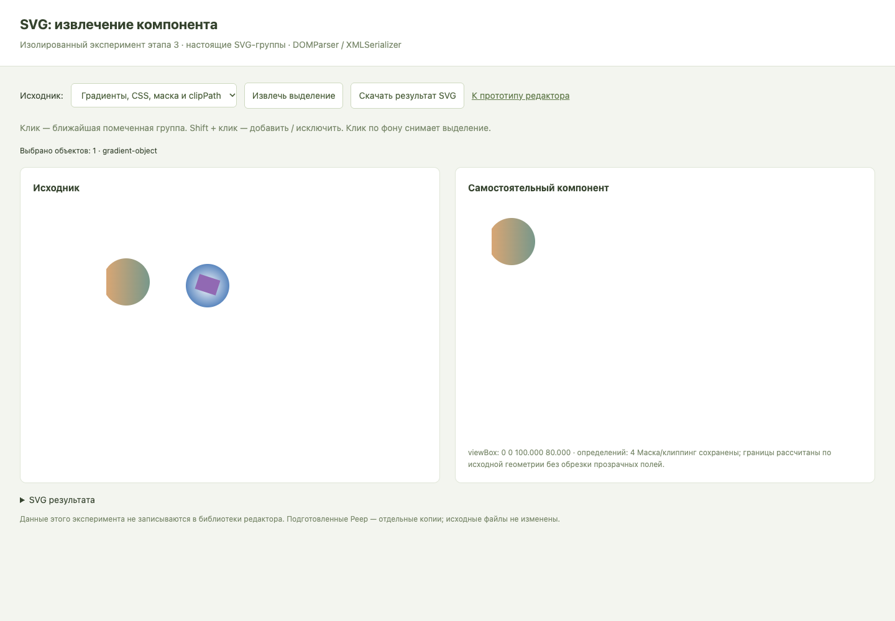

# Полный отчёт по этапу 3: техническая проверка извлечения SVG

> Обновление после аудита: отдельные экспериментальные страницы удалены; SVG-проверки сохранены в тестовых фикстурах. Старые URL в этом отчёте относятся к состоянию на момент этапа. [Актуальный аудит](audit-stages-1-9.md).

**Дата:** 18 октября 2026 года, Europe/Moscow.  
**Статус:** этап 3 выполнен в пределах явно описанного статического подмножества SVG.  
**Результат:** изолированный модуль извлечения, браузерная страница эксперимента, Vitest-тесты, проверки Playwright и сохраняемые доказательства.

## 1. Вывод

На трёх предоставленных Peep подтверждена возможность извлекать голову, позу и несколько объектов в самостоятельный векторный SVG. Дополнительные примеры подтвердили перенос локальных CSS-стилей, линейных/радиальных градиентов, транзитивных ссылок, clipPath и векторной маски. Вложенные трансформации, наследуемые цвета и групповые opacity сохраняются.

Для 11 визуальных случаев извлечённый результат сравнен с независимым эталоном из исходного SVG. В проверенном Chrome **максимальная разница пиксельных каналов — 0**, число отличающихся пикселей — 0. Каждый результат затем успешно открыт на новой странице после удаления страницы с исходником. Исходный DOM во время извлечения не изменён.

Проверено **36 тестов Vitest в Chrome**, **12 проверок Playwright эксперимента** и **9 регрессионных проверок прототипа**. Проверка TypeScript и production-сборка успешны. Тесты не используют заглушку getBBox.

Это подтверждение реализуемости основного подхода, но не полной совместимости со спецификацией SVG. Обводка и повороты могут давать прозрачные поля, маски/клиппинг не сжимают границы. Сложные случаи отклоняются явно; перечень ниже является текущим контрактом эксперимента.

## 2. Выполненные требования этапа

### Подробное задание «Этапы 1–3»

| Пункт | Статус | Доказательство |
| --- | --- | --- |
| Загрузка тестового SVG с группами, графикой и стилями/градиентами | Выполнено | Три Peep + `dependencies.svg` + `stroke.svg` |
| Парсинг через DOMParser | Выполнено | `parseSvg`, проверки XML/namespace/viewBox и допустимых конструкций |
| Программный выбор узла/группы | Выполнено | `selectBySelector`; неоднозначный или неподготовленный выбор отклоняется |
| Извлечение выбранного узла без изменения оригинала | Выполнено | `extractComponent`, проверки DOM до/после, неизменности файлов |
| Перенос связанных defs и уникальных ID | Выполнено | Транзитивное замыкание зависимостей, переписывание ID/href/url, тесты коллизий и циклов |
| Реальный локальный getBBox и viewBox по объекту | Выполнено с оговоркой о консервативных полях | Измерение в Chrome; размеры всех результатов приведены в разделе 7 |
| XMLSerializer и самостоятельный SVG | Выполнено | Сериализация, Blob-превью, скачивание и открытие после удаления исходника |
| Сохранение геометрии, цветов, градиентов | Выполнено для проверенного набора | 11 независимых визуальных сравнений без различий |
| Идемпотентность и изоляция | Выполнено | Одинаковое изображение при повторном извлечении, разные ID; повторная вставка без коллизий |
| Понятная ошибка неподдерживаемой конструкции | Выполнено | Стабильные коды `SvgExtractionError` и сообщения пользователю |

### Дополнительные требования общего ТЗ

- [x] Исходный SVG парсится и отображается.
- [x] Работают одиночный клик и Shift + клик по настоящим SVG-элементам.
- [x] Извлечённый объект сохраняется как самостоятельный SVG с объектным viewBox, градиентами и масками.
- [x] Программный код эксперимента отделён от основного редактора.
- [x] Следующий этап не начат.

## 3. Где находятся результаты

| Файл / каталог | Назначение |
| --- | --- |
| [`experiments/svg/extract.ts`](../experiments/svg/extract.ts) | Независимые функции парсинга, выбора, измерения и извлечения |
| [`experiments/svg/extract.test.ts`](../experiments/svg/extract.test.ts) | 36 Vitest-проверок в настоящем браузере |
| [`experiments/svg/index.html`](../experiments/svg/index.html), [`harness.ts`](../experiments/svg/harness.ts) | Страница ручного эксперимента: исходник, выбор, результат, код и скачивание |
| [`src/tests/svg-experiment.spec.ts`](../src/tests/svg-experiment.spec.ts) | 11 визуальных сравнений и один сценарий взаимодействия/скачивания/ID; перенесён на этапе 5 |
| [`vitest.config.ts`](../vitest.config.ts) | Chrome через браузерный провайдер Playwright |
| [`tsconfig.svg.json`](../tsconfig.svg.json) | Отдельная проверка TypeScript экспериментальных файлов |
| [`public/experiments`](../public/experiments) | Три подготовленных Peep и два дополнительных проверочных SVG |
| [`stage-3-artifacts`](stage-3-artifacts) | Самостоятельные SVG, эталоны, PNG-проверки и JSON-метрики |
| [`summary.json`](stage-3-artifacts/summary.json) | Сводные фактические результаты 11 визуальных случаев |



## 4. Проверенные входные данные

### Реальные файлы

| Предоставленный SVG | Исходный viewBox | Проверено извлечение |
| --- | --- | --- |
| `peep-sitting-7.svg` | 0 0 367 620 | Голова, поза |
| `peep-sitting-10.svg` | 0 0 324 484 | Голова, поза |
| `peep-standing-24.svg` | 0 0 321 692 | Голова, поза, голова + поза |

Оригинальные файлы находятся в `../материалы/исходники`. Их копии в `public/demo` совпадают с оригиналами побайтово. В отдельном `public/experiments` разрешённая пользователем подготовка добавляет `data-component="true"` на группы персонажа, головы и позы. Проверено сравнением XML-деревьев: кроме этих меток и формы XML-сериализации, рисунок/атрибуты/структура не изменены.

В Peep не было defs, градиентов, масок или CSS-блоков, поэтому тестирование только ими не подтвердило бы заявленные зависимости. Кроме того, внутри каждого Peep найдены повторяющиеся ID контуров `🎨-Background` и `🖍-Ink`; некоторые ID групп содержат слеши и звёздочки. Это учтено в переносе ID и выборе через корректные селекторы атрибутов.

### Дополнительные проверочные файлы

- [`dependencies.svg`](../public/experiments/dependencies.svg): наследуемые цвета, статические CSS-правила, групповой opacity, вложенные translate/rotate, linearGradient → href → базовый градиент, radialGradient, clipPath, mask, неиспользуемый градиент для проверки исключения лишних defs.
- [`stroke.svg`](../public/experiments/stroke.svg): отрицательное начало исходного viewBox, translate + rotate + неравномерный scale, толстая обводка, miter join и square cap.

Дополнительные файлы — технические тестовые фигуры. Они не подменяют требуемую библиотеку из 20 иллюстраций и не являются новыми сгенерированными объектами пользовательских композиций.

## 5. Как устроено извлечение

1. **Проверка до отображения.** DOMParser разбирает XML. Проверяются namespace, положительный конечный viewBox, поддерживаемые элементы, статические CSS-свойства и локальность ресурсов. Опасные и неподдерживаемые конструкции не вставляются в живой DOM.
2. **Изолированное отображение.** Импортированная копия помещается в отдельный Shadow DOM. Стили страницы редактора не могут перекрасить исходник. Для измерений SVG подключён к текущему документу браузера, а не остаётся только в XMLDocument DOMParser.
3. **Логический выбор.** От target клика определяется ближайший предок с `data-component="true"`. Обычный клик заменяет выбор, Shift добавляет/исключает. Непомеченные технические группы не становятся объектами автоматически. Программный селектор должен однозначно указывать объект.
4. **Нормализация набора.** Удаляются повторные узлы и потомки выбранного предка. Порядок задаётся исходным DOM, а не порядком кликов.
5. **Измерение.** getBBox каждого графического элемента переводится через его CTM в систему координат исходного SVG. Объединяются границы выбранного набора. Для обводки добавляется консервативный запас, учитывающий square caps и miterlimit.
6. **Сохранение контекста.** Клонируются нужные ветви родительских групп с transform и групповыми эффектами. Вычисленные поддерживаемые свойства оформления записываются непосредственно в результат. CSS-классы и исходные CSS-правила не переносятся, чтобы не влиять на соседние компоненты.
7. **Зависимости.** Из href/url-ссылок собираются транзитивные локальные зависимости. Неиспользуемые defs не копируются. Поддерживаемое определение может находиться и вне исходного defs; важно, чтобы ID был однозначным.
8. **Уникальные ID.** Каждый перенесённый узел получает `component-<UUID>-<номер>`. Одновременно переписываются локальные ссылки. Повторяющиеся исходные ID допустимы, пока ни одна ссылка не требует выбрать между ними. Неоднозначная ссылка или цикл — ошибка.
9. **Нормализация координат.** Внешний сдвиг `translate(-x, -y)` и viewBox `0 0 width height` убирают глобальное смещение, сохраняя внутреннее дерево transform. Просто удалять родительские transform нельзя.
10. **Результат.** XMLSerializer выдаёт строку самостоятельного SVG. Она показывается через Blob как отдельное изображение и может быть скачана. Растеризация в модуле отсутствует.

### Почему границы иногда содержат поля

Геометрический bbox, bbox с обводкой и границы после клиппинга — разные понятия; это различие описано в [спецификации SVG 2](https://www.w3.org/TR/SVG2/coords.html#BoundingBoxes). Эксперимент не полагается на одинаковую поддержку расширенных опций getBBox во всех браузерах.

Для повёрнутой фигуры преобразование углов её локального bbox может дать больший прямоугольник, чем минимальная рамка её реального контура. Запас под обводку также намеренно консервативен. Маска/clipPath сохраняются, но не уменьшают вычисленную рамку. Видимая графика не обрезается; возможны прозрачные поля. Это не перенос размера исходного холста.

Если эффект на частично извлекаемом предке зависит от полного objectBoundingBox этого предка, удаление соседей изменило бы эффект. Такой выбор отклоняется с предложением выбрать группу целиком. Объект, чьи измеренные границы выходят за исходный viewBox, тоже отклоняется: сохранение обрезания исходным viewport пока не реализовано.

## 6. Методика визуального доказательства

Для каждого случая:

1. Из подготовленного исходника модулем извлекается компонент; сохраняются размеры, предупреждения, число зависимостей и строка SVG.
2. **Отдельно строится эталон из полного исходного XML**, без функции извлечения: сохраняются исходные стили/defs/группы; несвязанные графические элементы скрываются; исходный viewBox кадрируется на полученные координаты.
3. Эталон и результат декодируются как отдельные SVG-изображения в одном Chrome и рисуются на двух тестовых canvas в одинаковом масштабе. Это только инструмент проверки; SVG результата не заменяется PNG.
4. Сравниваются alpha и premultiplied RGB. Порог значимого различия — более 10 из 255; разрешённая доля — менее 0,5% объединения видимых пикселей. **Фактически maxDelta = 0 во всех 11 случаях**, то есть пороги не скрыли различий.
5. До/после извлечения сравнивается сериализация исходного DOM — она должна совпасть.
6. Страница с исходником удаляется переходом на `about:blank`; тот же результат декодируется заново в новом документе.

Это проверяет сохранение вида и автономность в данном браузере. Не проверяет импорт во всех сторонних редакторах и не доказывает пиксельное совпадение между разными браузерами/операционными системами.

## 7. Фактические размеры и результаты

Округление только в таблице; в SVG/JSON сохранены исходные численные значения. Начало viewBox результата всегда `0 0`. Координаты x/y относятся к выделению в системе исходника.

| Случай | x; y в исходнике | width × height результата | defs | Отличий пикселей |
| --- | --- | --- | --- | --- |
| [Sitting 7 — голова](stage-3-artifacts/sitting-7-head.svg) | 0,897; 0,024 | 183,861 × 162,262 | 0 | 0 |
| [Sitting 7 — поза](stage-3-artifacts/sitting-7-pose.svg) | 2,221; 136,823 | 364,458 × 482,941 | 0 | 0 |
| [Sitting 10 — голова](stage-3-artifacts/sitting-10-head.svg) | 71,962; 0,558 | 122,772 × 135,600 | 0 | 0 |
| [Sitting 10 — поза](stage-3-artifacts/sitting-10-pose.svg) | 0,668; 103,532 | 322,627 × 379,679 | 0 | 0 |
| [Standing 24 — голова](stage-3-artifacts/standing-24-head.svg) | 88,009; 0,512 | 124,026 × 107,464 | 0 | 0 |
| [Standing 24 — поза](stage-3-artifacts/standing-24-pose.svg) | 0,136; 91,761 | 320,602 × 599,417 | 0 | 0 |
| [Standing 24 — множественный выбор](stage-3-artifacts/standing-24-multiple.svg) | 0,136; 0,512 | 320,602 × 690,666 | 0 | 0 |
| [CSS + градиент + mask + clipPath](stage-3-artifacts/gradient-mask-clip.svg) | 80; 65 | 100 × 80 | 4 | 0 |
| [Радиальный градиент + поворот](stage-3-artifacts/radial-rotated.svg) | 216,897; 66,897 | 88,205 × 88,205 | 1 | 0 |
| [Два объекта с CSS и зависимостями](stage-3-artifacts/css-multiple.svg) | 80; 65 | 225,103 × 90,103 | 5 | 0 |
| [Обводка + transform](stage-3-artifacts/stroke-transformed.svg) | −1,707; −2,135 | 278,018 × 192,496 | 0 | 0 |

Для каждого имени рядом находятся `<имя>.json`, `<имя>.png`, `<имя>-reference.svg` и `<имя>-reference.png`. Метрики дополнительно объединены в [summary.json](stage-3-artifacts/summary.json).

## 8. Фактический контракт поддержки

| Конструкция | Текущий статус | Ограничение / доказательство |
| --- | --- | --- |
| SVG с конечным положительным viewBox | Поддерживается | Без вложенных SVG viewport |
| g, path, rect, circle, ellipse, line, polyline, polygon | Реализовано | Реальные проверки включают path/rect/circle/line; каждый возможный вариант остальных примитивов отдельно не покрыт |
| Несколько логических объектов | Поддерживается | Взаимное расположение и исходный порядок рисования сохраняются |
| Вложенные translate/rotate/scale | Проверено | Peep, radial и stroke; общий механизм CTM применим к допустимым SVG transform |
| Наследуемые fill/stroke/color, fill-rule, currentColor, opacity | Проверено | Вычисленные поддерживаемые свойства и контекст групп |
| Статические локальные CSS-правила / inline style | Ограниченная поддержка | Разрешённые свойства оформления; без at-rules, CSS-переменных, escapes, псевдоклассов, attribute selectors, вложенности правил, CSS transform/геометрии |
| Локальные linearGradient/radialGradient | Проверено | Включая транзитивные href и legacy xlink:href |
| clipPath и векторная mask | Проверено | Сохраняются целиком; границы не сжимаются по их видимому результату; ограничения частичного выбора предков описаны выше |
| Повторяющиеся ID без ссылок | Проверено | Узлы получают разные ID |
| Ссылка на отсутствующий/повторяющийся ID, цикл | Отклоняется | Нет частично повреждённого результата |
| Толстая обводка / miter / square caps | Проверено | Консервативные поля; не минимальная видимая рамка |
| use, symbol, pattern | Не поддерживаются | Явная ошибка элемента; не обещаны как реализованные |
| Фильтры, маркеры, non-scaling-stroke | Не поддерживаются | Иначе нельзя обещать корректные границы |
| Внешние ресурсы и стили, растровые image | Не поддерживаются | Только автономная векторная графика |
| Текст/шрифты, foreignObject, script, события, анимации | Не поддерживаются | Контуры из предварительно подготовленного текста могут рассматриваться как path |
| Относительные размеры графических фигур/обводки | Не поддерживаются | Градиенты и маски сохраняют собственную семантику координат; относительная геометрия может зависеть от смены viewport |
| Transform на корневом svg | Не поддерживается | Transform внутренних групп поддерживается |
| Отсутствующий/некорректный viewBox, DTD/entities | Отклоняется | Ошибка до отображения |
| Исходное обрезание viewport, bbox-зависимый эффект частично извлечённого предка | Не поддерживаются | Ошибка с пояснением вместо изменения изображения |

Парсер — проверка ограниченного набора для эксперимента, не универсальная библиотека очистки произвольного SVG. Сейчас проверены контролируемые входные файлы; широкая загрузка пользовательских файлов и полный UX ошибок остаются своим этапам.

## 9. Ошибки и отрицательные сценарии

Ошибки имеют тип `SvgExtractionError`, программный `code` и сообщение на русском языке. Страница эксперимента показывает сообщение вместо сохранения некорректного результата.

| Код / группа кодов | Что означает |
| --- | --- |
| INVALID_XML / INVALID_SVG / INVALID_VIEWBOX | Неверный XML, namespace или размеры viewBox |
| UNSAFE_XML / UNSAFE_ATTRIBUTE | DTD/entities/внешняя XML-таблица стилей, обработчик события, xml:base |
| UNSUPPORTED_ELEMENT / UNSUPPORTED_EFFECT | Неизвестный элемент, фильтр/маркер/vector-effect |
| UNSUPPORTED_CSS / RELATIVE_UNITS | Непереносимые стили или относительная геометрия |
| EXTERNAL_RESOURCE / UNSUPPORTED_REFERENCE / INVALID_REFERENCE | Внешняя, неподдерживаемая или некорректная ссылка |
| NESTED_VIEWPORT / ROOT_TRANSFORM | Неподдерживаемая система координат |
| INVALID_SELECTOR / AMBIGUOUS_SELECTION / NOT_SELECTABLE | Некорректный, неоднозначный или неподготовленный выбор |
| EMPTY_SELECTION / INVALID_SELECTION | Нет выбранных объектов или передан посторонний узел |
| NOT_MOUNTED / INVALID_GEOMETRY / EMPTY_GEOMETRY | Нет живого SVG DOM или измеримой геометрии |
| MISSING_DEPENDENCY / AMBIGUOUS_REFERENCE / CYCLIC_DEPENDENCY / UNSUPPORTED_DEPENDENCY | Нельзя однозначно и полностью перенести зависимость |
| CONTEXTUAL_EFFECT / ROOT_CLIPPING | Частичный выбор изменил бы bbox-зависимый эффект или исходное обрезание |

Тесты покрывают положительные и отрицательные сценарии, но не заявляют отдельную веточную проверку каждого сообщения из таблицы. Ключевые отказы — XML, активное/внешнее содержимое, CSS, неподдерживаемые элементы/эффекты, выбор, отсутствующие/дублирующиеся/циклические ссылки и контекстные границы — проверены автоматически.

## 10. Найденные проблемы и принятые решения

1. **Повторяющиеся ID в реальных исходниках.** Префикс к старому ID не устранил бы дубликаты внутри одного компонента. Исправлено назначением уникального ID каждому узлу; неоднозначные ссылки запрещены.
2. **XMLDocument DOMParser считается connected.** Проверки `isConnected` оказалось недостаточно: SVG может быть подключён к отдельному XMLDocument, но не измеряться в живой странице. Добавлена проверка `ownerDocument === document`.
3. **Потеря родительского контекста.** Перенос только path/g не сохраняет наследование и матрицы Peep. Реализовано сохранение нужных ветвей групп и вычисленного оформления.
4. **Частичный выбор под bbox-зависимым эффектом.** Удаление соседних ветвей изменило бы рамку, относительно которой работает маска/clipPath. Такой случай теперь явно отклоняется.
5. **Обводка/поворот не равны геометрическому bbox.** Приняты консервативные поля и предупреждение, вместо обрезания контуров или ложного обещания минимальной рамки.
6. **Клик теста в перекрытую окружность.** Центр окружности в тестовом SVG перекрыт прямоугольником той же логической группы. Проверка переключена на видимый прямоугольник. Семантика выбора группы не изменена.
7. **Тип parentElement в TypeScript.** В обходе предков явно указан Element, чтобы корректно работать с SVG-родителями. Финальная сборка проходит.

## 11. Окружение и повторный запуск

Проверено: macOS, Node.js 25.6.1, npm 11.9.0, Google Chrome **155.0.8059.80**. Зависимости проекта закреплены `package-lock.json`: Vitest 4.1.12, @vitest/browser-playwright 4.1.12, Playwright Test 1.64.1, Vite 8.3.4, TypeScript 7.0.2.

Из каталога репозитория:

```sh
npm ci
npm run build
npm run test:svg
npm run test:svg:acceptance
npm run test:prototype
npm run dev
```

Ручная проверка: откройте `/experiments/svg/index.html` на адресе Vite из терминала. Выберите файл → клик/Shift-клик → «Извлечь выделение» → сравните результат → «Скачать результат SVG». Дополнительное подтверждение экспорта основного редактора к этой отдельной лабораторной странице не относится.

Для тестов нужен установленный Google Chrome (`channel: chrome`); дополнительный Chromium не скачивается. Vitest запускает тесты через официальный [браузерный провайдер Playwright](https://vitest.dev/config/browser/playwright). Playwright acceptance использует dev-сервер 127.0.0.1:5173; уже работающий сервер сохраняется. Производственная сборка включает страницу эксперимента.

## 12. Что осталось за пределами этапа

- Подключение реального извлечения к основному редактору/БЭ — этап 7. На `/` остаётся прототип с условными областями выделения.
- Архитектура и модель данных/JSON/IndexedDB — этап 4; Zustand и постоянное хранение сейчас не добавлялись.
- Полноценные трансформации экземпляров, сохранение композиций и экспорт сцены — их последующие этапы. Скачивание одного извлечённого SVG в эксперименте не означает готовность экспорта композиции.
- Поддержка всех SVG, внешних шрифтов/ресурсов и произвольного CSS не заявляется.
- Другие браузеры, сторонние редакторы, большие/сложные файлы и нагрузочные пределы не проверялись.
- Оставшиеся 17 иллюстраций ожидаются от пользователя. Проверочные фигуры не засчитываются в 20 исходников.

Оснований считать невыясненным способ обработки трёх текущих исходников нет. Дополнительные SVG нужно проверять на соответствие зафиксированному подмножеству; новые конструкции могут потребовать расширения модуля или понятного отказа. Этап 4 не начат.
