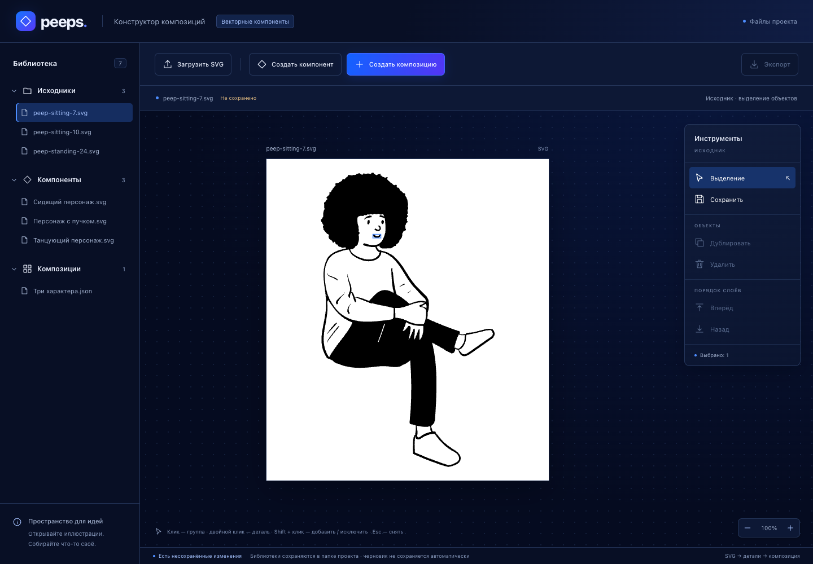
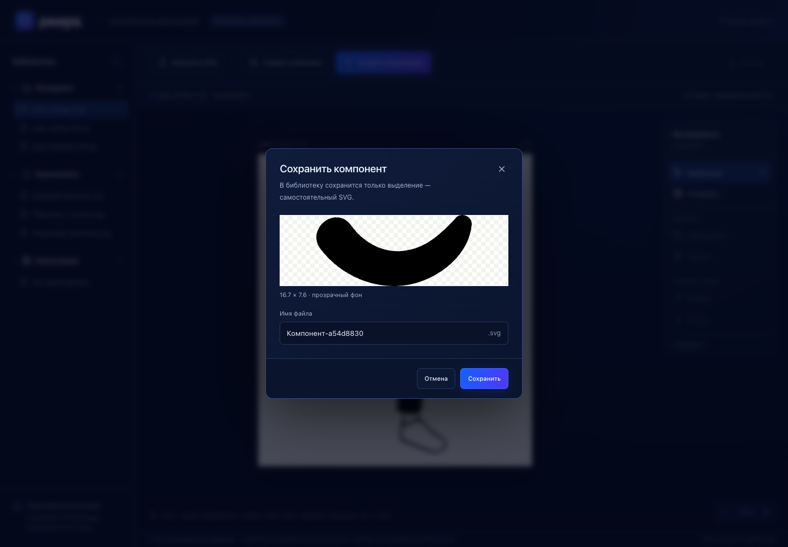

# Этап 7: просмотр исходника и извлечение в библиотеку компонентов

> Обновление после аудита: отдельные экспериментальные страницы удалены; SVG-проверки сохранены в тестовых фикстурах. Старые URL в этом отчёте относятся к состоянию на момент этапа. [Актуальный аудит](audit-stages-1-9.md).

Дата: 18 октября 2026 года. Этап завершён в рамках согласованного статического подмножества SVG и управления без Alt. Новый обработчик работает на главной странице редактора `/`.

## Результат

Исходник из БИ открывается настоящим SVG в основном холсте. Один клик выбирает ближайшую группу; двойной клик — самую мелкую доступную деталь; Shift + клик добавляет/исключает такую деталь, Esc снимает выделение. Несколько объектов имеют общую рамку. Если выбран родитель, Shift по его детали заменяет родителя деталью и сохраняет остальные независимые выбранные объекты.

Вместо условных областей «Голова/Поза» и копирования целого персонажа редактор теперь извлекает выбранную геометрию. На каждом из трёх Peep отдельно доступны рот, нос, глаза и брови. Отверстия составного контура остаются с деталью.

Кнопка «Сохранить» сначала готовит самостоятельный SVG. Диалог показывает именно этот результат, его размеры и предупреждения, предлагает уникальное имя. Подтверждение записывает SVG в `components` через существующий сервис IndexedDB; новая запись с превью появляется слева и остаётся после перезагрузки. Исходник не редактируется.

Отмена сохраняет выделение. Конфликт имени и ошибка записи оставляют диалог, имя и снимок результата для повтора. Только успешная запись снимает выделение и завершает переход к другому документу, если сохранение вызвано защитным диалогом.





## Приёмка по описанию этапа 7

| Требование | Результат и доказательство |
| --- | --- |
| Исходник из БИ без искажения пропорций/цветов | Живой SVG в изолированном Shadow DOM, сохранённые viewBox/preserveAspectRatio; три Peep и загруженные технические SVG |
| Кнопки +/− масштабируют только просмотр | 50–200%, CSS scale артборда; проверки при 50/100/200% и неизменный XML до/после |
| Обычный клик | Выбор ближайшего настоящего `g`, включая группы без семантического имени |
| Глубокий выбор | Двойной клик по нарисованной части; все 18 деталей лиц проверены в основном редакторе |
| Множественный выбор | Shift добавляет/исключает самую мелкую доступную деталь, рамка объединяет выбор; Alt не используется по указанию пользователя |
| Собственный viewBox | `0 0 width height` и перенос исходной системы координат через translate; сохранённый рот имеет размер детали, один path, а не размер персонажа |
| Сохранение оформления/defs | Общий проверенный экспортёр; bbox-ресурсы фиксируются перед сокращением геометрии; линейный/радиальный градиент, clipPath и mask прошли сохранение и независимый рендер |
| Изоляция ID | UUID каждому перенесённому узлу, ссылки переписаны; повторные извлечения имеют непересекающиеся ID, десять экземпляров отображаются из изолированных SVG-изображений |
| Имя → IndexedDB → превью БЭ | Реальная запись `components`, отображение списка, перезагрузка, создание композиции с новым компонентом |
| Исходник неизменен | Сравнение DOM и полных записей sources; оригиналы материалов и public/demo побайтово совпадают |
| Unit-проверки | 64 Vitest в реальном Chrome, включая топологию, геометрию, зависимости и ID |
| Сквозная проверка | 106 Playwright: прежние 95 и 11 новых сценариев интеграции |

Слова «самая мелкая» относятся к безопасно отделяемой детали: отверстие рта не становится самостоятельной заливкой, а слитая линия головы не разрезается по предполагаемой анатомии.

## Код и поток данных

| Файл | Назначение |
| --- | --- |
| [SourceCanvas.tsx](../src/components/SourceCanvas.tsx) | Монтаж/удаление SVG и проб, CTM, нативные события, общая рамка, типизированный `extract(ids)` |
| [App.tsx](../src/App.tsx) | Открытие исходника, снимок извлечения, превью/имя, ошибки и успешное сохранение/переход |
| [src/svg/base.ts](../src/svg/base.ts) | Прежний проверенный экспортёр: проверка подмножества, Shadow DOM, стили, контекст групп, границы, зависимости, UUID и сериализация |
| [model.ts](../src/svg/model.ts), [topology.ts](../src/svg/topology.ts) | Виртуальные кандидаты и безопасное разбиение составных путей |
| [resources.ts](../src/svg/resources.ts), [extract.ts](../src/svg/extract.ts) | Исходные bbox-координаты ресурсов, материализация выбранных подконтуров в рабочей копии, самостоятельный SVG |
| [stage7.spec.ts](../src/tests/stage7.spec.ts) | Интеграционная приёмка через пользовательский интерфейс и настоящую IndexedDB |
| [sourceHelpers.ts](../src/tests/sourceHelpers.ts) | Независимые ожидаемые контуры Peep и координаты для настоящих кликов по рисунку |

Алгоритм перенесён из эксперимента в `src/svg` без дублирования. Файлы `experiments/svg/extract.ts` и `experiments/svg-v2/{model,topology,resources,extract}.ts` теперь служат совместимыми экспортами. Старые 36 SVG unit-проверок, новые проверки и обе страницы лабораторий используют те же production-функции, что и основной редактор.

Геометрия загружается вместе с `SourceCanvas` через `React.lazy`, при открытии исходника. Пустой редактор не загружает Paper.js для анализа путей. DOM, Paper-объекты и модель выбора хранятся в refs компонента; Zustand содержит только временные ID выбора и масштаб. Для скорости выбора используются кэши кандидатов и проб, а не повторный разбор пути на каждом клике.

Схема IndexedDB осталась версии 1, формат композиции также не менялся. Миграция/очистка пользовательских библиотек не выполнялась. Сервис хранения не был переписан; вместо целого исходника ему передаётся новый самостоятельный SVG.

## Проверки и артефакты

Успешны `npm run build` и `npm test`: 64 Vitest и 106 Playwright. Браузер — Google Chrome 155.0.8059.80 на macOS; Node 25.6.1, npm 11.9.0.

11 новых сквозных сценариев покрывают:

1. Все шесть деталей каждого из трёх лиц: настоящие клики, двойные клики, превью вырезанной геометрии и отмена. Отдельно для каждого исходника — набор глаз через Shift при 50/100/200%, повторное исключение, Esc и сравнение исходного DOM/хранилища.
2. Сохранение одного рта: записанный SVG равен превью, содержит один path и небольшой viewBox. После перезагрузки превью декодируется, компонент используется в композиции. Удаление исходника не мешает использованию компонента, удаление компонента не повреждает сохранённую сцену.
3. Отмена, дубликат имени и искусственный отказ IndexedDB с `QuotaExceededError`: нет лишней записи и ложного успеха; повтор сохраняет тот же снимок.
4. Четыре ресурсных случая: загруженный SVG → выбранная правая деталь → имя → IndexedDB → пустая страница без исходника → сравнение с независимым эталоном. Для linearGradient, radialGradient, bbox clipPath и bbox mask **maxDelta = 0**.
5. Неподдерживаемый `use` даёт ошибку открытия и недоступное сохранение. Viewport-зависимый процентный градиент даёт устойчивое сообщение об ошибке извлечения, без сохранения целого файла вместо детали.
6. Повторное извлечение одного объекта даёт разные ID; десять экземпляров нового компонента декодируются как отдельные SVG-изображения.

Прежние 52 визуальных случая нового алгоритма и 11 первого стенда повторно прошли без различий пикселей. Контрольные эталоны не строятся новым алгоритмом. Старые сценарии библиотек и интерфейса, использовавшие фиктивные области «Голова/Поза», переведены на настоящие клики по лицу и продолжают проверять имена, сохранение и защиту переходов.

Результаты: [сводка](stage-7-artifacts/summary.json), [каталог доказательств](stage-7-artifacts), [самостоятельный рот](stage-7-artifacts/mouth.svg), [linear](stage-7-artifacts/linear.svg), [radial](stage-7-artifacts/radial.svg), [clip](stage-7-artifacts/clip.svg), [mask](stage-7-artifacts/mask.svg), [повторное использование](stage-7-artifacts/repeated.json).

## Границы поддержки

Сохраняется согласованный контракт [повторного этапа 3](stage-3-v2.md). Этап 7 не означает совместимость с любыми SVG:

- Поддерживаются статическая векторная графика, группы, допустимые примитивы, вложенные SVG-transform, разрешённые свойства CSS, локальные градиенты/маски/clipPath и их проверенные зависимости.
- Волосы, слитые с лицом/линией головы в один непрерывный контур, не восстанавливаются в отдельную причёску. Для такой детализации нужна подготовка контуров.
- `use/symbol`, pattern, фильтры, текст, растр, анимации, внешние ресурсы, вложенные SVG и произвольный CSS не поддерживаются обработчиком. Хранение некоторых более широких статических SVG допустимо; если файл нельзя разобрать для выделения, холст показывает причину.
- Viewport-зависимые процентные `userSpaceOnUse`-ресурсы отклоняются при извлечении. Числовые координаты и проверенные bbox-варианты работают. Исходное обрезание корневым viewport имеет прежний отказ `ROOT_CLIPPING`.
- Рамка вычисляется по геометрии; для обводки/поворота и масок возможны консервативные прозрачные поля. Минимальная рамка видимых пикселей не заявляется.
- Другие браузеры и большие новые иллюстрации требуют отдельной проверки. Оставшиеся 17 иллюстраций по-прежнему ожидаются от пользователя.

## Проверка вручную

```sh
npm ci
npm run dev
```

Открыть `/` на адресе Vite → двойной клик по исходнику в библиотеке → двойной клик по рту или глазу → при необходимости Shift по другим деталям → «Сохранить» справа → проверить превью и имя → «Сохранить». После перезагрузки новая запись остаётся в «Компонентах».

Повторный запуск приёмки:

```sh
npm run build
npm test
# Только новые сквозные сценарии:
npm run test:stage7
```

Тестам нужен установленный Google Chrome (`channel: chrome`). Playwright-команды не запускаются параллельно в одном checkout.

Следующие этапы — работа с трансформациями экземпляров и конечным экспортом/импортом композиции. Данный этап завершает именно путь «исходник → выделенная деталь → библиотека компонентов».
