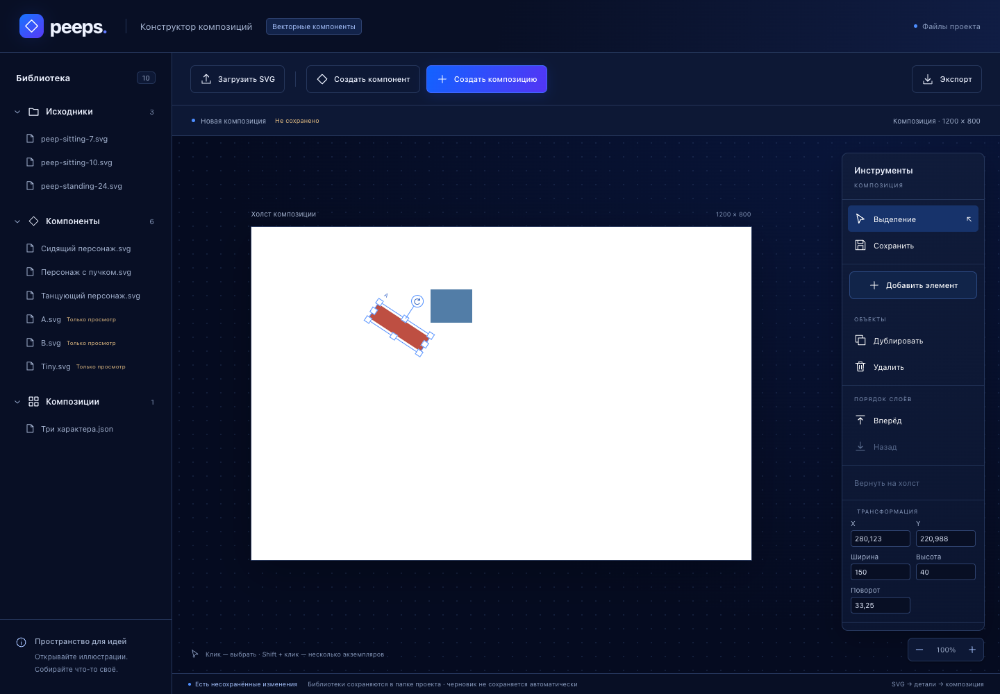

# Этапы 8–9: композиция, перемещение, масштабирование и поворот

18 октября 2026 года. Основание: «материалы/Этапы 7-9.docx» и указание пользователя выполнить оба этапа. Реализация подключена к основному редактору `/`.

## Результат

Композиция собирается через попап с мультивыбором. Компоненты добавляются в порядке отметки, с независимыми instanceId, координатами и SVG-снимками. Их можно перетаскивать по одному или выбранной группой, дублировать, удалять и менять соседние слои.

У одного выбранного экземпляра работают восемь маркеров размера и ручка поворота. Углы сохраняют текущие пропорции, боковые маркеры меняют одну ось. При resize противоположный угол/край остаётся на месте; rotation идёт вокруг центра. Инструменты учитывают масштаб просмотра 50–200% и прокрутку рабочей области.

В правой панели доступны X, Y, ширина, высота и угол. Новые параметры сохраняются в существующий JSON/IndexedDB и точно восстанавливаются при открытии. Библиотечный компонент и другие экземпляры того же компонента не изменяются. Исходники и выделение этапа 7 не переработаны.



## Чек-лист этапа 8

| Требование | Реализация и проверка |
| --- | --- |
| Новая композиция, мультивыбор, минимум три исходника | Сквозной тест извлекает по глазу из каждого из трёх Peep, выбирает их в порядке 24 → 7 → 10, создаёт сцену и проверяет порядок |
| Независимые экземпляры и начальный порядок | Новые instanceId; координаты x = 160 + (n mod 3) × 270, y = 150 + floor(n / 3) × 60; новые партии дописываются сверху |
| Свободное перетаскивание | Pointer Events и захват указателя, отдельный/групповой drag, фактический DOMRect → координаты 1200 × 800 |
| Дублирование без новых библиотечных файлов | Новый instanceId, тот же SVG-снимок и происхождение, смещение +20/+20; состав библиотеки не меняется |
| Удаление без повреждения оригинала | Удаляется экземпляр из массива сцены; проверяется неизменность библиотечных записей |
| Соседние слои | Обмен мест в массиве и соответствующий порядок DOM; проверены настоящие перекрытия через elementFromPoint, а не только индексы |

Начальные размеры берутся из собственного SVG, поэтому извлечённый глаз больше не растягивается в фиксированную рамку целого персонажа. При добавлении большой группы компоненты могут перекрываться; пользователь свободно размещает их на холсте.

## Чек-лист этапа 9

| Требование | Реализация и проверка |
| --- | --- |
| Интерактивная рамка, углы и боковые маркеры | Восемь кнопок-маркеров с захватом указателя; рамки находятся в верхнем слое и доступны даже при перекрытии рисунков |
| Пропорциональные углы | Сохраняется отношение текущих ширины/высоты, включая ранее растянутый объект |
| Независимые оси по бокам | Меняется только соответствующий масштаб; второй остаётся неизменным |
| Вращение вокруг центра | Приращение atan2 разворачивается через ±180°, нет скачка при полном обороте; проверен жест на 450° |
| Стабильность при zoom | Drag и rotation проверены при 50/100/200%, все восемь resize-маркеров — при 50/200% на объекте, повёрнутом на 37° |
| Параметры в стейте | Сохранены координаты, независимые масштабы и поворот без округления до экранных пикселей; повторное открытие даёт те же значения |
| Векторность и сериализация | SVG-снимки не меняются и не переводятся в bitmap. Есть проверенный эквивалентный SVG-transform; параметры сериализуются прежним projectFromDocument |

Размер ограничен снизу 0,01 SVG-единицы: перетягивание через противоположный край не создаёт отрицательный масштаб или зеркальное отражение. Для совсем мелких деталей рамка визуально расширяется до 32 CSS-пикселей до zoom, сохраняя точный размер самого рисунка; точные поля позволяют работать и с такими экземплярами.

## Координаты и трансформации

Номинальные w/h получаются из viewBox; при его отсутствии используются числовые width/height, затем fallback 250 × 450 для старых SVG без размеров. x/y обозначают верхний левый угол неповёрнутой масштабированной рамки. Центр:

`cx = x + w × scaleX / 2`, `cy = y + h × scaleY / 2`.

Эквивалентный SVG-transform локального viewport:

```text
translate(cx cy) rotate(rotation) scale(scaleX scaleY) translate(-w/2 -h/2)
```

Ненулевое начало собственного viewBox остаётся внутри SVG-изображения. Экранный коэффициент 0,6 и zoom не записываются в проект. Эта математика проверяется в настоящем DOMMatrix через SVG transform: центр и углы совпадают с независимо рассчитанными координатами.

При resize delta переводится в локальные повёрнутые оси. Угловой маркер проецирует движение на исходную диагональ, сохраняя текущие пропорции; боковой меняет одну длину. Затем пересчитывается центр и x/y так, чтобы сохранить противоположный якорь. Расчёт идёт от снимка начала жеста, без последовательного накопления округлений.

При rotation сохраняется центр, а угол накапливается короткими приращениями без скачка через границу atan2. Угол может превышать 360°. Escape, pointercancel или потеря захвата отменяют незавершённый жест к снимку. Неподтверждённое числовое поле фиксируется до снимка следующего pointer-жеста и не теряется при его начале.

Независимый resize применяется к самой SVG-графике: изображение сначала получает исходные пропорции, затем CSS scale по осям; внешняя рамка поворачивается вокруг центра. При одной лишь смене viewport встроенный SVG оставлял бы поля из-за preserveAspectRatio. Эта проблема обнаружена визуально, воспроизведена падающим пиксельным тестом и исправлена как на холсте, так и в превью библиотеки.

## Код

- [CompositionCanvas.tsx](../src/components/CompositionCanvas.tsx): слои экземпляров, верхний слой рамок, выбор, Pointer Events, захват и отмена жестов.
- [TransformFields.tsx](../src/components/TransformFields.tsx): точный ввод, проверка конечности/положительного размера, подтверждение Enter/blur.
- [transforms.ts](../src/services/transforms.ts): размеры, центр, resize, углы, SVG-transform; кэш размеров ограничен 256 SVG.
- [views.ts](../src/services/views.ts): порядок/начальные позиции новых экземпляров, прежняя сериализация.
- [LibraryPanel.tsx](../src/components/LibraryPanel.tsx): превью сцены с теми же размерами, масштабом и центром поворота.
- [transforms.test.ts](../src/tests/transforms.test.ts) и [stages89.spec.ts](../src/tests/stages89.spec.ts): автоматическая приёмка.

Новые библиотеки не добавлены. Схема IndexedDB и schemaVersion остаются 1; пользовательская база не очищалась и записи не мигрировались. Сервис хранения и SVG-обработчик этапа 7 не изменены. Естественные размеры SVG заменяют условные размеры прежнего рендерера, поэтому старые прототипные сцены теперь отображаются по фактическим параметрам своих компонентов.

## Проверки

Сборка TypeScript/Vite и общий набор: **96 Vitest + 134 Playwright**. Из них новые: **32 unit-проверки и 28 сценариев браузера**.

Unit-набор включает 24 комбинации «8 маркеров × 3 угла», независимые точные расчёты при 90°, положительный минимум, переход угла через шов, естественные размеры, SVG transform, сохранение дробных координат и порядок добавления.

Новые браузерные сценарии:

- Три реально извлечённых источника, порядок отметки, дублирование/удаление и соседние слои.
- Отдельный и групповой drag при 50/100/200%.
- Все восемь маркеров при 50/200% на повёрнутом объекте; сохранённый якорь и независимость другого экземпляра.
- Rotation на 450° при 50/100/200% с сохранением/перезагрузкой.
- Отмена жеста Escape, точные числа, повторное открытие и естественный размер Tiny 3 × 8.
- Окрашенные перекрытия и доступность рамки перекрытого объекта.
- Пиксели независимо растянутого SVG на холсте и в превью сохранённой композиции.
- Изменение и удаление копии не затрагивают исходный экземпляр того же компонента и библиотеку.
- Числовое поле, не подтверждённое Enter, сохраняется при начале drag.

В старом наборе повторно проверяются библиотеки, ошибки записи/отмены, извлечение, ID, маски/градиенты и неизменность исходников. Тесты используют настоящий Chrome, SVG DOM и IndexedDB, реальные движения мыши. Программно читается состояние для проверки, но жесты не заменяются прямой записью параметров в Zustand.

Артефакты: [сводка](stages-8-9-artifacts/summary.json), [точные параметры после открытия](stages-8-9-artifacts/reopened.json), [пиксели растяжения на холсте](stages-8-9-artifacts/nonuniform-canvas.png), [превью](stages-8-9-artifacts/nonuniform-preview.png).

## Повторный запуск и ручная проверка

```sh
npm run build
npm test
# Только приёмка этапов 8–9:
npm run test:stages89
npm run dev
```

Для тестов нужен установленный Google Chrome; Playwright-команды не запускаются одновременно в одном checkout. Проверено на macOS, Node 25.6.1, npm 11.9.0, Chrome 155.0.8059.80.

На `/`: «Создать композицию» → отметить компоненты → создать → выбрать экземпляр → перетащить его, угловой/боковой маркер или ручку поворота. Числа правятся справа. Сохранить сцену, перезагрузить и открыть её из библиотеки: трансформации и слои восстановятся.

Общий поворот/resize множества, привязки, отражение, undo/redo и автопрокрутка при удержании у края не входят в эти два задания. Групповой перенос работает; трансформация рамкой применяется к одному выбранному экземпляру. Скачивание композиции SVG и импорт/экспорт JSON остаются следующим этапам. Несохранённый черновик по-прежнему не восстанавливается после перезагрузки. Другие браузеры не проверялись.
